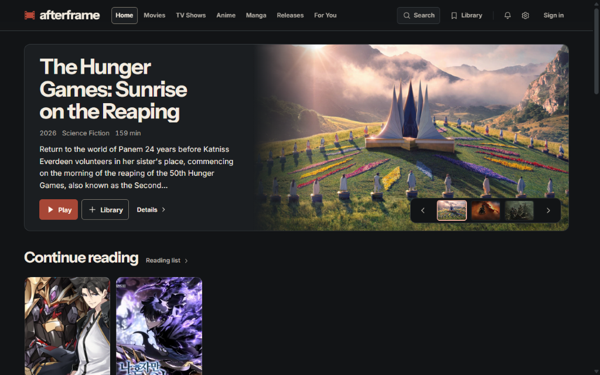
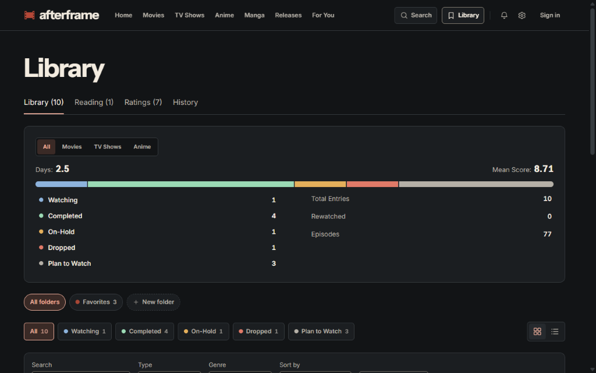
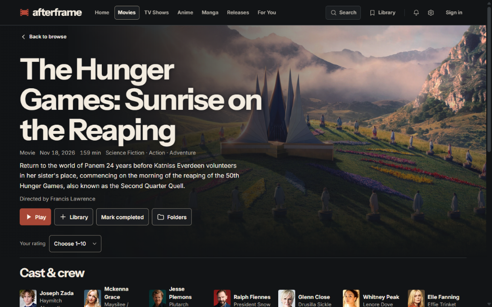
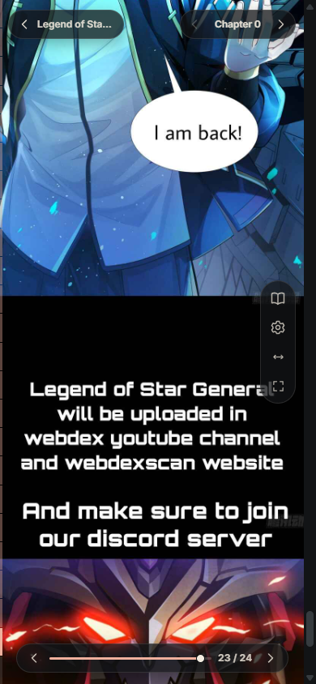

<div align="center">
  
  <h1>Afterframe</h1>
  <p><strong>A self-hosted personal media library, video player, and manga reader for movies, TV shows, anime, and manga.</strong></p>

  <p>
    
    
    
    
    
  </p>

  
</div>

---

## Overview

**Afterframe** brings discovery, tracking, playback, and manga reading into one fast, editorial dark-mode web application. Run it locally on Node.js, self-host with Docker Compose, or deploy to Railway with PostgreSQL-backed accounts and multi-device sync.

### Key Features

- **Unified Discovery & Search**
  - Browse Movies, TV Shows, Anime (with seasonal schedules and airing countdowns), Manga (manga, manhwa, manhua, comics), Weekly Releases, and personalized **For You** picks.
  - Filter by genre, decade, release year range, runtime, and IMDb/MAL ratings, or press `/` / `Ctrl+K` (`⌘K`) anywhere for instant command palette search.
- **Personal Library, Stats & Custom Folders**
  - Track watch and reading statuses (`Watching`, `Completed`, `On-Hold`, `Dropped`, `Plan to Watch`), 1–10 personal ratings, custom color-coded folders, and day-grouped watch history.
  - Built-in **Library Statistics** filterable across `All`, `Movies`, `TV Shows`, and `Anime`, showing time watched, mean score, status distribution bar, and episode totals.
  - **Auto-add as Watching** (enabled by default in **Settings → Playback**) automatically adds series and movies to your Library as `Watching` once you complete an episode or make meaningful playback progress.
  - Works seamlessly in Guest Mode (local browser storage) or signed-in accounts synced across devices.
- **Smart Video Player**
  - Resumes exact playback position, tracks actual watched coverage per episode, and supports automatic next-episode playback with a cancellable countdown.
  - Verified **Intro / Recap / Credits** skipping powered by [AniSkip](https://aniskip.com/) and [TheIntroDB](https://theintrodb.org/) with confidence guards and a one-click **Undo** pill.
  - Keyboard shortcuts (`Space`, `←/→`, `F`, `S`) and subtitle/audio/quality preference persistence.
- **Immersive Manga Reader**
  - Built-in reader supporting **Long strip** (default on mobile, full-bleed edge-to-edge with `0px` gaps), **Single**, and **Double** page spreads with RTL/LTR direction and image fit controls.
  - Auto-hiding translucent floating controls on scroll, tap-to-reveal capsules, an ultra-thin `3px` clickable edge progress bar (`Left` / `Bottom` / `Right` / `Off`), centered Settings & Chapters modals, screen dimming, grayscale mode, and true-black OLED canvas.
  - Aggregates chapters from [MangaDex](https://mangadex.org/) alongside fallback English/Spanish chapter sources and optional publisher-authorized text transcripts.

---

## Screenshots

<table>
  <tr>
    <td width="50%" valign="top">
      <strong>Personal Library, Filterable Stats &amp; Custom Folders</strong><br /><br />
      
    </td>
    <td width="50%" valign="top">
      <strong>Title Details, Ratings &amp; Cast</strong><br /><br />
      
    </td>
  </tr>
</table>

<details open>
  <summary><strong>Mobile Manga Reader (Edge-to-Edge Long Strip &amp; Subtle Floating Controls)</strong></summary>
  <br />
  <div align="center">
    
  </div>
</details>

---

## Architecture

| Workspace | Purpose |
| --- | --- |
| `apps/web` | Unified React 19 + Vite + TypeScript frontend (discovery, Library, video player, manga reader, Settings, Base UI dialogs/popovers) + static/proxy web server (`server.mjs`). |
| `apps/api` | Node.js HTTP API serving catalog proxies, AniBridge anime mappings, AniSkip/TheIntroDB skip timings, MangaDex/chapter aggregation, release notifications, and SQLite/PostgreSQL account storage. |
| `packages/shared` | Shared design tokens (`theme.css`), playback tracking math, comic display helpers, and discovery utilities shared between `web` and `api`. |
| `afterframe` | Public icons/artwork and local runtime configuration/data directory (ignored by git). |

---

## Quick Start

### 1. Run Locally (Node.js 22.19+)

```sh
npm ci
npm run build
npm start --workspace @afterframe/api
```

Open [http://localhost:4173](http://localhost:4173). By default the server binds to loopback (`127.0.0.1`). Set `PORT` in the environment or `afterframe/.env` to customize the port.

#### Development Mode (Hot Reload)

Run the API and Vite dev server in two terminals:

```sh
npm run dev:api
```

```sh
npm run dev:web
```

Open [http://localhost:5174](http://localhost:5174). Set `AFTERFRAME_API_URL` if the API runs on a port other than `4173`.

### 2. Run with Docker Compose

Build and start the `web`, `api`, and `PostgreSQL` stack from the repository root:

```sh
docker compose up -d --build --wait
```

To pass existing catalog keys from `afterframe/.env`:

```sh
docker compose --env-file afterframe/.env up -d --build --wait
```

Only the web service port (`4173` by default, override with `AFTERFRAME_PORT`) is published on loopback. Account and library data persists in the `postgres-data` volume.

### 3. Deploy to Railway

Deploy two app services (`web` and `api`) backed by a `Postgres` service, with `/api/health` configured as the healthcheck path on both services and a public HTTPS domain attached to `web`.

| Service | Required Environment Variables |
| --- | --- |
| `web` | `AFTERFRAME_SERVICE=web`, `PORT=8080`, `AFTERFRAME_API_URL=http://${{api.RAILWAY_PRIVATE_DOMAIN}}:8080`, `AFTERFRAME_ORIGIN=https://your-public-domain` |
| `api` | `AFTERFRAME_SERVICE=api`, `PORT=8080`, `AFTERFRAME_ORIGIN=https://your-public-domain`, `AFTERFRAME_ACCOUNTS_DATABASE_URL=${{Postgres.DATABASE_URL}}`, `DATABASE_URL=${{Postgres.DATABASE_URL}}` |

For image-backed Railway deploys, build matching `linux/amd64` Docker targets (`--target web` and `--target api`) with versioned tags and connect each service to its corresponding image tag.

---

## Configuration & Integrations

Catalog credentials can be configured via **Settings → Integrations** (in local single-host installs) or environment variables (recommended for Docker/Railway and required in public HTTPS deployments):

| Variable | Description |
| --- | --- |
| `TMDB_READ_TOKEN` / `TMDB_API_KEY` | Required for the full Movies & TV catalog ([Get a TMDb key](https://www.themoviedb.org/settings/api)). |
| `OMDB_API_KEY` | Optional — supplies IMDb scores and vote counts ([Get an OMDb key](https://www.omdbapi.com/apikey.aspx)). |
| `MAL_CLIENT_ID` | Optional — supplies MyAnimeList scores for mapped anime and manga ([MAL API](https://myanimelist.net/apiconfig)). |
| `DATABASE_URL` | Optional — enables persistent PostgreSQL metadata caching (falls back to in-memory cache). |
| `AFTERFRAME_ACCOUNTS_DATABASE_URL` | Optional — stores accounts and libraries in PostgreSQL instead of `afterframe/data/accounts.sqlite`. |
| `AFTERFRAME_ORIGIN` | Public HTTPS origin when running behind a reverse proxy or on Railway. |
| `AFTERFRAME_REGISTRATION` | Set to `closed` to disable new account sign-ups after creating your accounts. |
| `AFTERFRAME_ANNOUNCEMENTS_FILE` | Optional JSON file path for verified upcoming season announcements (`seriesId`, `season`, `source`). |
| `AFTERFRAME_COMIC_TRANSCRIPTS_FILE` | Optional JSON file path for publisher-authorized manga chapter text transcripts. |
| `MANGADEX_BLOCKED_GROUPS` | Optional comma-separated MangaDex scanlation group IDs to exclude. |

### Migrating SQLite Accounts to PostgreSQL

Stop writes to the SQLite database, set `AFTERFRAME_ACCOUNTS_DATABASE_URL` to an empty PostgreSQL database, and run:

```sh
npm run import:accounts --workspace @afterframe/api -- /path/to/accounts-snapshot.sqlite
```

This preserves account IDs, password hashes, libraries, folders, playback preferences, recovery codes, and release notification history.

---

## Testing & Verification

```sh
npm run typecheck   # TypeScript checks across web & API
npm run lint        # ESLint across apps/api, apps/web/src, packages/shared/src
npm test            # Node test runner (API) + Vitest (web)
npm run build       # Production Vite bundle
```

---

## Credits & Attribution

- Movie and TV metadata by [TMDB](https://www.themoviedb.org/) (this product uses the TMDB API but is not endorsed or certified by TMDB).
- Regional streaming availability by [JustWatch](https://www.justwatch.com/).
- Anime episode mappings by [AniBridge](https://github.com/anibridge/anibridge-mappings); skip segments by [AniSkip](https://aniskip.com/) and [TheIntroDB](https://theintrodb.org/).
- Manga catalog and chapter artwork by [MangaDex](https://mangadex.org/) and credited scanlation groups.
- Public-domain and Creative Commons editions via the [Internet Archive](https://archive.org/) and [Wikimedia Commons](https://commons.wikimedia.org/).
